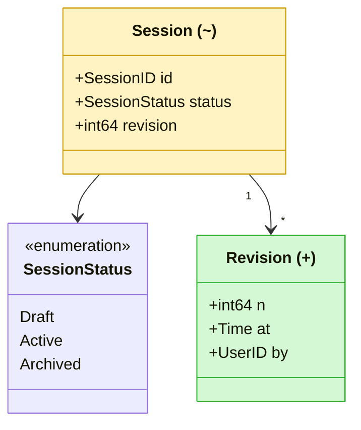
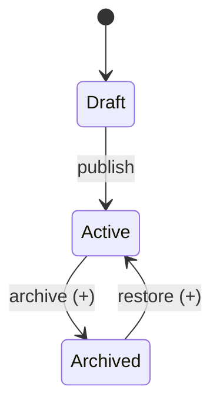
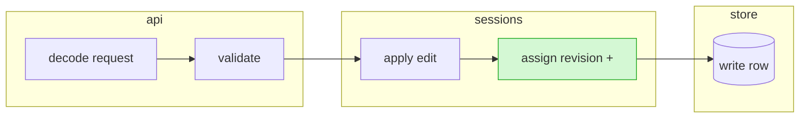
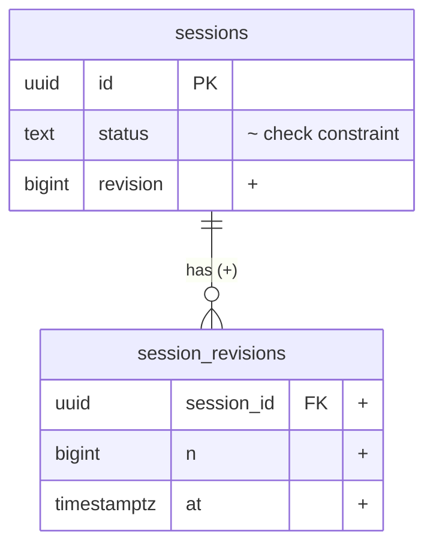
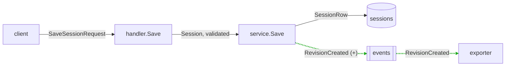
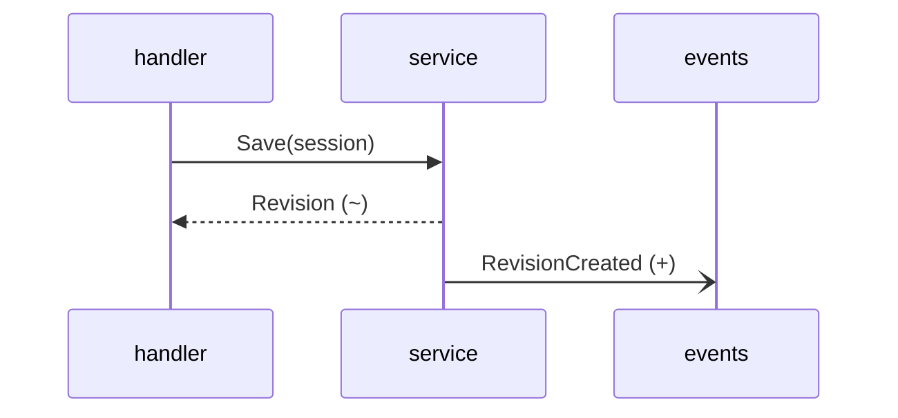
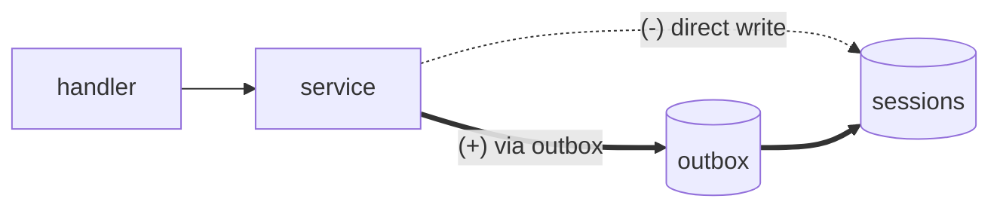

# Visual components

## Legend

When marking changes, use one legend across the whole document and state it once near the top:

| Mark | Meaning   | Color   |
| ---- | --------- | ------- |
| `+`  | added     | green   |
| `~`  | changed   | amber   |
| `-`  | removed   | red     |
|      | unchanged | no fill |

Always pair color with the text mark. Renderers differ in which diagram types accept styling, and the text mark keeps its meaning in all of them. Define styles with `classDef` and apply them with `class` statements in flowcharts. In class diagrams, append `:::name` to the class declaration, because a separate `class` statement declares a new class instead. Style flowchart edges with `linkStyle`. In ER, sequence, and state diagrams, put the mark in the label.

Show changed elements plus one hop of neighbors. When a diagram grows past about fifteen nodes, split it by responsibility instead of shrinking the text.

## Types and interfaces

**Signature diff.** Strip bodies and show only declarations, before and after.

```diff
 type SessionStore interface {
   Get(ctx context.Context, id SessionID) (Session, error)
-  Save(ctx context.Context, s Session) error
+  Save(ctx context.Context, s Session, opts SaveOptions) (Revision, error)
+  History(ctx context.Context, id SessionID) ([]Revision, error)
 }
```

**Contract delta.** One row per changed field or parameter. The Breaking and Affected columns are what a reviewer needs and what the diff does not show.

| Field              | Before   | After                | Breaking         | Affected                  |
| ------------------ | -------- | -------------------- | ---------------- | ------------------------- |
| `Session.status`   | `string` | `SessionStatus` enum | yes, on the wire | web client, `exporter.go` |
| `Session.revision` | absent   | `int64`, required    | no, server-set   | none                      |

**Type graph.** A class diagram of the types.



**State diagram.** Use one for an enum, status field, or tagged union. Mark new transitions, and list the states the change makes impossible.



**Interface conformance.** Rows are interface methods and columns are implementations, including fakes and mocks.

| Method    | `pgStore` | `memStore` | `fakeStore` |
| --------- | --------- | ---------- | ----------- |
| `Save`    | ~ updated | ~ updated  | ~ updated   |
| `History` | + added   | + added    | missing     |

## Data objects

**Example payload.** One realistic object before and after, so the reader sees values next to the type.

```diff
 {
   "id": "s_19f",
-  "status": "active",
+  "status": "ACTIVE",
+  "revision": 7,
   "title": "Q3 plan"
 }
```

**Serialization map.** One row per field across each representation. It exposes naming drift, lossy conversions, and fields present on only one side.

| Go field    | JSON        | Column       | Note                  |
| ----------- | ----------- | ------------ | --------------------- |
| `Revision`  | `revision`  | `revision`   | + new everywhere      |
| `UpdatedAt` | `updatedAt` | `updated_at` | JSON drops sub-second |
| `Draft`     | absent      | `is_draft`   | storage only          |

**Lifecycle.** Lanes are the modules that own each step: create, validate, change, persist, emit, delete.



**Field trace.** Follow one new or changed field from where it is set to every place that reads it.

| Step   | Location               | What happens                     |
| ------ | ---------------------- | -------------------------------- |
| set    | `sessions/save.go:41`  | revision increments on each save |
| stored | `store/queries.sql:12` | written to `sessions.revision`   |
| read   | `api/session.go:88`    | returned to the client           |

## Tables

**ER neighborhood.** An ER diagram of the tables.



**Column diff.** One row per changed column.

| Column     | Before | After                        | Index              |
| ---------- | ------ | ---------------------------- | ------------------ |
| `status`   | `text` | `text`, check in enum values | unchanged          |
| `revision` | absent | `bigint not null default 0`  | + `(id, revision)` |

**Deploy compatibility matrix.** Use it for any schema or wire change. It answers whether the migration must ship before the code.

|              | Old schema              | New schema                |
| ------------ | ----------------------- | ------------------------- |
| **Old code** | works                   | works, ignores `revision` |
| **New code** | fails, reads `revision` | works                     |

**Migration timeline.** Phases in deploy order, with what each one locks or rewrites.

| Phase    | Ships with | Change                        | Lock or rewrite        |
| -------- | ---------- | ----------------------------- | ---------------------- |
| expand   | deploy 1   | add nullable `revision`       | brief lock, no rewrite |
| backfill | job        | set `revision` in batches     | row locks per batch    |
| contract | deploy 2   | set not null, drop old column | validation scan        |

**Query-to-column map.** Which queries read or write each changed column, and which index serves them.

**Sample rows.** Three representative rows before and after a backfill or transform.

**Config map.** One row per setting across environments or layers. It exposes drift and precedence.

| Setting          | Local | Prod            | Precedence        |
| ---------------- | ----- | --------------- | ----------------- |
| `SESSION_TTL`    | `1h`  | `15m`           | env over file     |
| `OUTBOX_ENABLED` | on    | on (+) enforced | file, no override |

## Flow

**Labeled flowchart.** Label each arrow with the type it carries.



**Call tree diff.** The functions a path calls, indented by depth, with added and removed calls marked. Anchor the frames the reader needs to open.

```diff
 handler.Save                     api/session.go:30
   decodeRequest
   service.Save                   sessions/save.go:22
     store.Get
+    checkRevision                sessions/revision.go:14
     store.Write
+    outbox.Enqueue               outbox/outbox.go:51
-  cache.Invalidate
```

**Call stack.** The frames active at one point of interest, innermost first. Use it to show where a value is set, an error is raised, or a new hook runs, and every caller that reaches it.

```text
outbox.Enqueue          outbox/outbox.go:51    (+)
service.Save            sessions/save.go:48    (~)
handler.Save            api/session.go:37
http.(*ServeMux).ServeHTTP
```

**Sequence diagram.** Use it when timing, retries, or async steps matter. Mark changed messages in their labels.



**Before and after in one diagram.** Draw removed paths dashed and added paths thick, in a single diagram, so the reader compares without switching views.



**Error flow.** Where each error starts, how each layer wraps it, and what the caller finally sees.

| Origin                 | Wrapped as         | Caller sees  |
| ---------------------- | ------------------ | ------------ |
| unique violation in pg | `ErrConflict`      | HTTP 409     |
| revision mismatch      | `ErrStaleRevision` | HTTP 412 (+) |

**Event map.** Producers, topics, and consumers, including consumers in other repositories.

**Responsibility tree.** Which module or service owns each path or capability.

```text
sessions/               # owns revision rules
├── save.go             # service.Save (~)
└── revision.go         # checkRevision (+)
store/                  # owns persistence
└── queries.sql         # sessions.revision (+)
api/                    # owns HTTP boundary
└── session.go          # handler.Save (~)
```

**Pseudocode.** The algorithm or decision logic in plain steps. Use it when control flow matters more than the code shape.

```text
on Save(session)
  if revision is stale
    return ErrStaleRevision
  assign next revision
  write row
  enqueue RevisionCreated
```

**Control-flow diff.** Pseudocode as a diff, for a state or control-flow change.

```diff
 on(save)
-  write content
+  if content is unchanged
+    return cached result
+  write new content
+  invalidate cache
```

## Layout

**Layout tree.** The proposed file and package shape as a nested tree, marking each path as new, modify, or move with its responsibility.

```text
src/
├── api/
│   └── session.go        # modify — validates and serves save requests
└── sessions/
    ├── save.go           # modify — owns save rules
    └── revision.go       # new — owns revision checks
```

**File-layout diff.** The layout tree as a diff, for a file or package move.

```diff
 src/
 ├── commands/
+│   └── show-me.ts       # expands the slash command
 ├── sessions/
-└── transport.ts
+└── transport/
+    ├── client.ts
+    └── stream.ts
```

**Deliverable matrix.** Maps each deliverable to its outcome, owning paths, and acceptance criteria.

| ID  | Outcome             | Paths                  | Accepts                              |
| --- | ------------------- | ---------------------- | ------------------------------------ |
| D1  | stale save rejected | `sessions/revision.go` | 412 on stale; suite green            |
| D2  | revision persisted  | `store/queries.sql`    | row carries revision; backfill clean |

## UI

**UI component tree.** Structure, props and state, and module boundaries that matter.

```tsx
<SessionPage> (apps/example/src/routes/session.tsx)
  useSessionEvents()
  <SessionToolbar>
    <RunSaveButton> (packages/ui)
  <SessionTimeline>
    <RevisionCard /> (+)
```

**Component diff.** The UI tree as a diff, for a component change.

```diff
 <SessionPage>
   useSessionEvents()
   <SessionToolbar>
+    <RunSaveButton />
   <SessionTimeline>
+    <RevisionCard />
```

**Screenshot reference.** A captioned baseline image plus its capture conditions, for UI or parity work.

```markdown

Viewport 1440px · seeded rows 1-3 · revision badge visible
```

## Selecting views

| What the section covers     | Primary view                          | Supporting view             |
| --------------------------- | ------------------------------------- | --------------------------- |
| Public API or interface     | Signature diff                        | Interface conformance       |
| Struct or payload fields    | Contract delta                        | Example payload             |
| Enum, status, or union      | State diagram                         | List of impossible states   |
| Table or migration          | ER neighborhood, compatibility matrix | Migration timeline          |
| One field end to end        | Field trace                           | Serialization map           |
| New path or service hop     | Labeled flowchart                     | Sequence diagram            |
| Calls within one path       | Call tree diff                        | Call stack                  |
| Where something happens     | Call stack                            | Field trace                 |
| Events or async work        | Event map                             | Sequence diagram            |
| Error handling              | Error flow                            | Labeled flowchart           |
| Module or entity ownership  | Lifecycle                             | Type graph                  |
| Service or path ownership   | Responsibility tree                   | Lifecycle                   |
| Algorithm or core logic     | Pseudocode                            | Labeled flowchart           |
| File or package layout      | Layout tree                           | Responsibility tree         |
| Deliverable coverage        | Deliverable matrix                    | Responsibility tree         |
| Settings or env drift       | Config map                            | Deploy compatibility matrix |
| UI structure or state       | UI component tree                     | Screenshot reference        |
| Visual parity or regression | Screenshot reference                  | UI component tree           |
| UI change                   | Component diff                        | UI component tree           |
| Layout change               | File-layout diff                      | Layout tree                 |
| Logic change                | Control-flow diff                     | Pseudocode                  |

## Accuracy rules

- Prefer views generated from the project's own artifacts over views drawn by hand. Examples are emitted type declarations, an API description, a schema dump, or migration output. For a change, generate them at both pinned revisions and diff them. For a data model, generate them at its one pinned revision. For a proposal, label views as proposed and anchor them to source and spec paths instead of claiming a pinned head revision. Use the tools the project already has.
- Label each view with its source: generated from a named artifact at a revision, or drawn by hand from cited `file:line` locations.
- Check that every type, field, table, column, function, and event named in a view exists at the pinned revision, or for a proposal, in the cited source or proposed spec paths. Search for any name you did not read directly.
- Render each Mermaid diagram when a renderer is available, and fix any that fail. When none is available, say the diagrams were not rendered. Keep to common Mermaid syntax, because GitHub and Plannotator run different Mermaid versions. Unrendered diagrams fail most often on a semicolon inside a sequence message, which ends the statement, and on unquoted parentheses or brackets in flowchart labels.
- In a change tour or proposal, show before and after against the pinned base (or proposal base), not against memory of earlier code.
